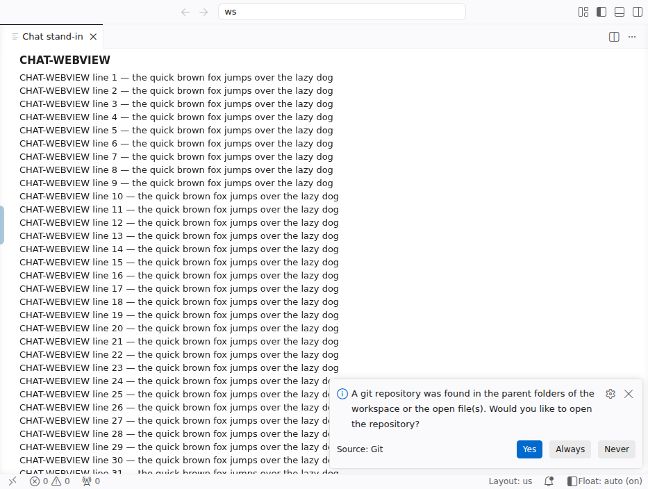
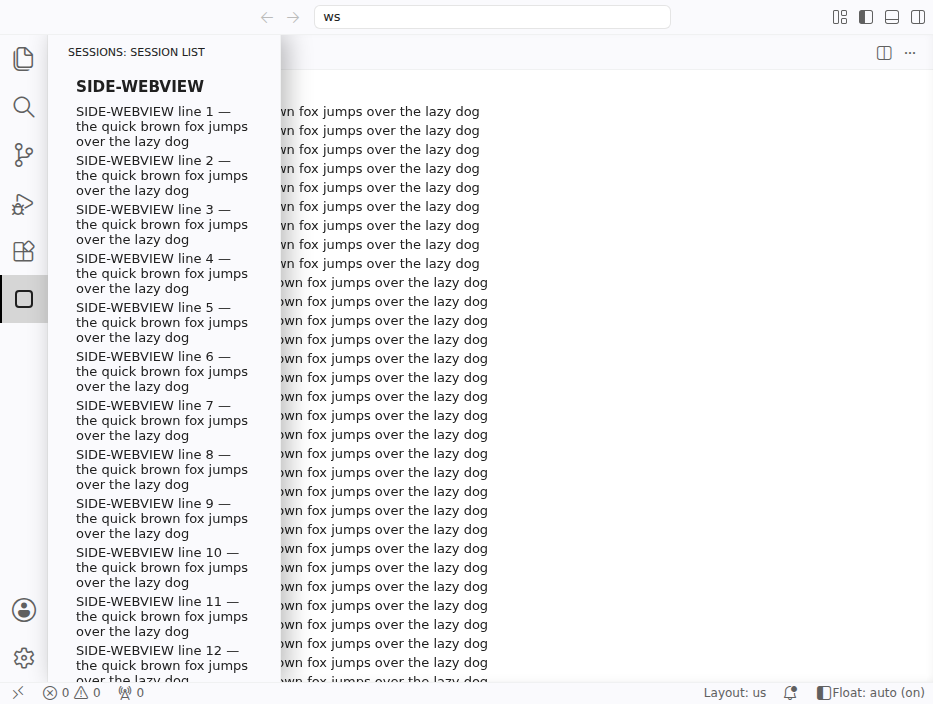
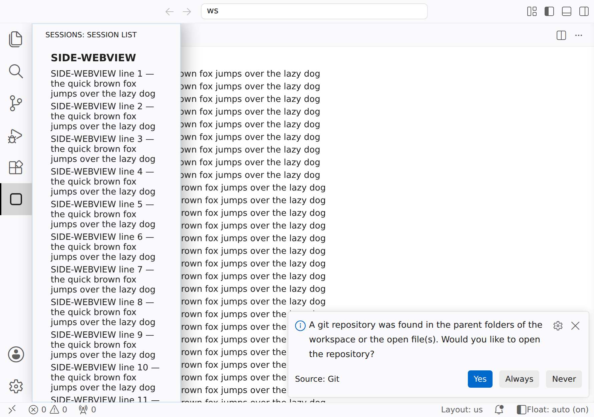

# 浏览器版 VS Code 的浮动侧栏

[English](README.md) | 简体中文

让 **code-server** 和 **openvscode-server** 的左侧栏**浮在编辑区上面**弹出，而不是把编辑区挤窄。适合折叠屏手机的内屏、平板和小窗口：侧栏不用时不占地方，要用时盖在上面，Claude Code、Codex 这类聊天面板的排版一点都不动。

<p align="center"></p>

<p align="center"><i>iPhone Duo 内屏（890 × 626 pt），code-server 全屏，Float on。<a href="docs/media/float-sidebar-iphone-duo.mp4">MP4 版</a> · <a href="demo/">制作方法</a></i></p>

| 侧栏收起：编辑区占满全宽 | 侧栏弹出：浮在上面，编辑区不动 |
|---|---|
|  |  |

*933 × 704 CSS 像素，相当于 7.6–8 寸折叠屏内屏。编辑区里是一个 webview，代替 Claude Code、Codex、Copilot Chat 这类聊天面板。*

## 为什么做这个

手机内屏大约 850–950 CSS 像素宽，左侧栏一开就占掉三分之一。用 Ctrl+B 或者自动隐藏插件开关侧栏，编辑区和聊天面板每次都要重新排版：文字重新折行，长回复上下跳动。这个脚本让侧栏根本不参与布局，需要时才从左边滑出来，盖在上面。

## 怎么用

| | 鼠标 / 键盘 | 触屏 |
|---|---|---|
| 弹出侧栏 | 鼠标贴到屏幕最左边，或按 **Ctrl+B**（Mac 上是 ⌘B） | 点左边缘的小把手 |
| 收起 | 鼠标移开、点别处、按 **Esc** 或 **Ctrl+B** | 点别处 |
| 切换模式 | 点状态栏的 **Float: …**，或按 **Ctrl+Alt+Shift+B** | 点状态栏的 **Float: …** |

有三种模式：

- **auto**：窗口窄于 1400 CSS 像素时浮动。
- **on**：总是浮动。
- **off**：VS Code 原来的布局。

模式由每个浏览器各自记住，所以手机上可以浮动，台式机的大屏上照常停靠。

其他功能都不变：拖动调整侧栏宽度、切换资源管理器 / 搜索 / 插件等视图、右键菜单、侧栏里的 webview 都照常可用。



## 安装

在运行服务器的那台机器上：

```sh
git clone https://github.com/wilsonzhang2/vscode-web-float-sidebar.git
cd vscode-web-float-sidebar
sudo ./float-sidebar.sh install            # 自动寻找 code-server / openvscode-server
# 或者指定安装目录：
sudo ./float-sidebar.sh install /usr/lib/code-server
```

装好后刷新浏览器标签页即可，不用重启服务器。只有服务器文件属于 root 时才需要 `sudo`（比如用 .deb/.rpm 包装的 code-server）。

```sh
./float-sidebar.sh status      # 查看装在哪里
sudo ./float-sidebar.sh uninstall
```

**每次升级服务器后，要再运行一次 `install`。** 升级会覆盖被修改的文件；重复运行不会出问题。在 Debian/Ubuntu 上，可以让 code-server 包升级后自动重新安装（路径改成你克隆本仓库的位置）：

```sh
echo 'DPkg::Post-Invoke { "/opt/vscode-web-float-sidebar/float-sidebar.sh install /usr/lib/code-server || true"; };' \
  | sudo tee /etc/apt/apt.conf.d/99float-sidebar
```

Docker 镜像（加进你的 Dockerfile）：

```dockerfile
# gitpod/openvscode-server
COPY vscode-web-float-sidebar /opt/float-sidebar
RUN /opt/float-sidebar/float-sidebar.sh install /home/.openvscode-server

# codercom/code-server
COPY vscode-web-float-sidebar /opt/float-sidebar
RUN sudo /opt/float-sidebar/float-sidebar.sh install /usr/lib/code-server
```

建议把网页装成应用（PWA：Chrome/Edge 的“安装”，Safari 的“添加到主屏幕”）。在应用模式下整个屏幕都归你，被浏览器占用的快捷键也更少。

## 它改了什么

- 在 `…/out/vs/code/browser/workbench/workbench.html` 里加一个 `<script>` 标签，把 `float-sidebar.js` 复制到同一目录。第一次安装时，原文件备份为 `workbench.html.float-sidebar.orig`。
- 不发任何网络请求，不收集任何信息，不改设置和插件。

## 原理

VS Code 按 `window.innerWidth` 计算工作台大小。脚本让它读到一个更宽的值，正好多出侧栏（加图标栏）的宽度，同时把整个工作台向左移同样的距离。这样 VS Code 会把侧栏排在屏幕左边缘之外，编辑区和右侧栏正好占满可见区域。弹出侧栏只是一个 CSS 平移，别的部分都不会重新排版。另外还处理了几处细节：

- 侧栏里的 webview 在单独的一层里，由 VS Code 自己定位。脚本让它们跟着侧栏一起移动，并放在侧栏上面。
- 标题栏和状态栏固定在可见区域内。
- 快速打开（Quick Open）重新居中到屏幕上。
- 找不到预期的结构时（不认识的 VS Code 版本，或侧栏放在右边），脚本报告正常宽度，工作台就跟没装一样。

## 兼容性和限制

| | 状态 |
|---|---|
| code-server 4.138.0（VS Code 1.138.0） | 自动化测试通过 |
| openvscode-server 1.109.5 | 自动化测试通过 |
| Chrome / Edge / Android Chrome | 应该可用（测试用 Chromium 跑） |
| iPhone / iPad 上的 Safari | 应该可用（VS Code 在 iOS 上用 `visualViewport` 计算布局，脚本也处理了），但还没在真机上测过 |
| 真实手机和平板 | 还没测过；测试是在 Chromium 里模拟触屏 |
| Claude Code / Codex 面板 | 还没用真实插件测过；测试用的是放在相同位置的替身 webview |

限制：

- 只支持侧栏在**左边**（默认位置）。
- 如果底部面板设成横跨整个窗口（`panel alignment: justify`），它最左边的一段会被藏在侧栏底下。
- 依赖 VS Code 的内部实现：`window.innerWidth`、`.part.*` 类名、webview 层。以后的版本可能让它失效。升级你赖以工作的服务器之前，先用新版本跑一遍测试。

## 测试

`test/` 里有：

- 一个测试插件：侧栏里放一个 webview，编辑区放一个当“聊天面板”的 webview。
- 一个启动临时服务器的脚本。
- 一套端到端测试，每个服务器 36 项检查，用 Playwright 驱动无头 Chromium。覆盖布局、鼠标贴边、Ctrl+B、Esc、触屏、右键菜单、快速打开、三种模式、窗口缩放和 2560 像素宽的大屏。

```sh
cd test && npm install
CS_DIR=/path/to/code-server-copy OVS_DIR=/path/to/openvscode-server ./servers.sh start
../float-sidebar.sh install /path/to/code-server-copy /path/to/openvscode-server
node e2e.mjs http://127.0.0.1:8091/
node e2e.mjs "http://127.0.0.1:8092/?folder=$PWD/.work/ws"
./servers.sh stop
```

想知道侧栏为什么弹出或收起，在浏览器控制台运行 `localStorage.setItem('floatSidebar.debug', '1')` 后刷新，每次弹出 / 收起都会在控制台记下原因。

测试时请用服务器的**副本**，不要用你正在工作的那个服务器。如果 Playwright 的无头浏览器不在默认位置，用 `CHROME=/path/to/chrome` 指定。

## 许可

MIT。本项目与 Microsoft、Coder、Gitpod 均无关联。
